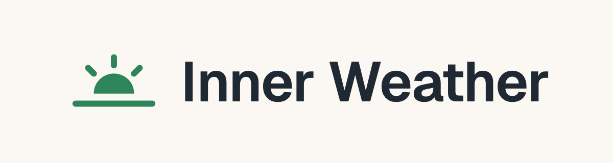

# Brand

Status: built 2026-11-15 · Last updated: 2026-11-15

## What it is

Inner Weather has one mark: a sun clearing a horizon, drawn as a half disc, a horizon line and three short rays, in the app's accent green on its warm paper background. The name is set beside it in Geist semibold, the app's own typeface. Together they are the lockup.

The idea is the product's: weather that is inside you, changing, and never a verdict. A sunrise says "it clears" without promising anything, which matches an app that rates how things usually are and suggests one small step.

## Where it appears

- **First screen, first round** (`mobile/app/index.tsx`): the `Hero` block, centred on the paper with a hairline below: the mark at 64 px, the name at 30 px and the tagline "Feel stuck? Find where to look first, then take one small step." The owner asked for a proper brand presence on 2026-11-15 after a 40 px lockup still felt like a label. Four versions were tried that day: a rounded green panel (felt like a card dropped onto the page), a left-aligned header (lost the presence), a square-cornered green band, a left-aligned version on the paper, and this one, centred with the hairline and no colour, which the owner preferred. The second round and sign-in show the smaller `Brand` lockup, so the question, not the brand, leads once the person is in.
- **App icon, favicon, splash icon and the Android adaptive icon layers** in `mobile/assets/`. The adaptive icon background colour in `app.json` is the paper colour.
- **Browser tab title** on web: "Inner Weather", set once in the root layout.
- **README** header and this page.
- **Demo video** title and closing cards (`docs/demo/`), which the demo session owns.

## How it is built

- `mobile/assets/brand/mark.svg` is the source drawing, a 100 × 100 viewBox.
- `mobile/src/components/Brand.tsx` draws the same geometry with `react-native-svg`, so it is crisp at any size on web and native. `Mark` is the symbol alone; `Brand` is the lockup. The paths are copied rather than imported, because Metro would need an SVG transformer for that; change both files together.
- `mobile/assets/brand/render.mjs` renders every PNG from the SVG with Playwright's Chromium, borrowed from `docs/demo/node_modules` (run `npm install` there first), then `node mobile/assets/brand/render.mjs` from the repo root. The sizes and backgrounds are listed in that file: the iOS icon is opaque paper because Apple masks the corners itself; the favicon and splash icon are the bare mark on transparency; the Android foreground keeps to the centre 66% safe zone and the monochrome layer is white so the system can tint it.

## Decisions

- **One tagline, kept in code** (`TAGLINE` in `Brand.tsx`) — so the hero, the demo and the README say the same thing about what the app does.
- **A sunrise, not a cloud or a monogram** — the three options considered on 2026-11-15. The cloud with a gap of light needed two colours or a gradient to read, and a monogram says nothing about the product. The sunrise survives at 16 px and needs one colour.
- **Accent green rather than a sun yellow** — one brand colour, already used for every primary button, keeps the palette calm. A warm yellow sun would have pulled the eye on every screen and clashed with the rating band colours.
- **No gradients, no rounded-square tile baked into the icon** — flat shapes render the same everywhere and the platforms add their own masks.
- **SVG in the repo rendered by a script, not hand-exported PNGs** — the mark can be tuned and re-rendered in one command, and the app component and the icons cannot drift apart silently.
- **Nothing like storms, rain or thermometers** — the app must never feel like a verdict or a diagnosis.

## Future

- A dark-mode variant of the lockup if the app gains a dark theme (the mark itself works in any single colour).
- Proper splash screen configuration through `expo-splash-screen` when the native phase starts; `splash-icon.png` is ready for it.
